<h1 align="center">Vitor Musachio</h1>

<h3 align="center">Senior Data & AI Engineer · São Paulo, Brazil (UTC−3)</h3>

  
  
  
  
  
  

I design and build data platforms and the AI systems that run on top of them. I am currently a senior specialist Data & AI Engineer at [QuintoAndar](https://github.com/quintoandar). I have worked with data since 2017, and since 2023 my focus has been data engineering and AI.

I also teach. Between 2022 and 2025 I taught the Data Engineering course at Awari and mentored students in data and software engineering.

## 🧭 What I do

- 🏗️ **Data platforms.** Batch and streaming pipelines, lakehouse and warehouse modeling, orchestration, and data quality.
- 🤖 **AI engineering.** Getting AI workloads into production on a data foundation that can be trusted.
- 🎓 **Teaching and mentoring.** Turning production experience into courses, hands-on labs, and one-to-one guidance.

## 🏢 Where I work

  
  <strong><a href="https://github.com/quintoandar">QuintoAndar</a></strong>
   
  Senior specialist Data & AI Engineer, working on the data platform and AI products for B2B and Marketplace operations.

 

  
  <strong><a href="https://github.com/itnavent">Navent</a></strong>
   
  Part of the QuintoAndar group, running its Latin American operation. I work on migrating and unifying the data platforms of the two companies, and on the AI ecosystem.

 

Across both, my focus is on the B2B and marketplace products. Both organizations keep their code private, and that is where most of my contributions go.

## 🚀 Selected work

  
  

- **[discogs-data-lake](https://github.com/VitorMusachio/discogs-data-lake).** A lakehouse built on the Discogs API with a medallion architecture (bronze, silver, gold), ending in fact and dimension tables served for analytics. Airflow, Spark, MinIO, Trino, Metabase, Docker Compose.
- **[awari-by-fluency-engenharia-de-dados](https://github.com/VitorMusachio/awari-by-fluency-engenharia-de-dados).** The Docker workspace, DAGs, and notebooks I used to teach the Data Engineering course at Awari. Airflow, MinIO, PostgreSQL, Metabase, JupyterLab, Docker Compose.

The projects above are public and documented in Portuguese.

## 🎓 Teaching

- **Instructor, Data Engineering course**, Awari (Jun 2023 – Mar 2025)
- **Mentor, data and software engineering**, Awari (May 2022 – Mar 2025)

## 🛠️ Toolkit

**Languages**

**Data**

**Cloud and infrastructure**

## 📊 GitHub activity

  
  

  <picture>
    <source media="(prefers-color-scheme: dark)" srcset="./profile/snake-dark.svg" />
    
  </picture>

## 🤝 Working together

Alongside my full-time role, I take on a small number of freelance and consulting projects in data engineering and AI: platform design, pipeline builds, architecture reviews, and team training. I work remotely from São Paulo, with working hours that overlap with both the Americas and Europe.

If you have a project in mind, message me on [LinkedIn](https://linkedin.com/in/vitormusachio).
